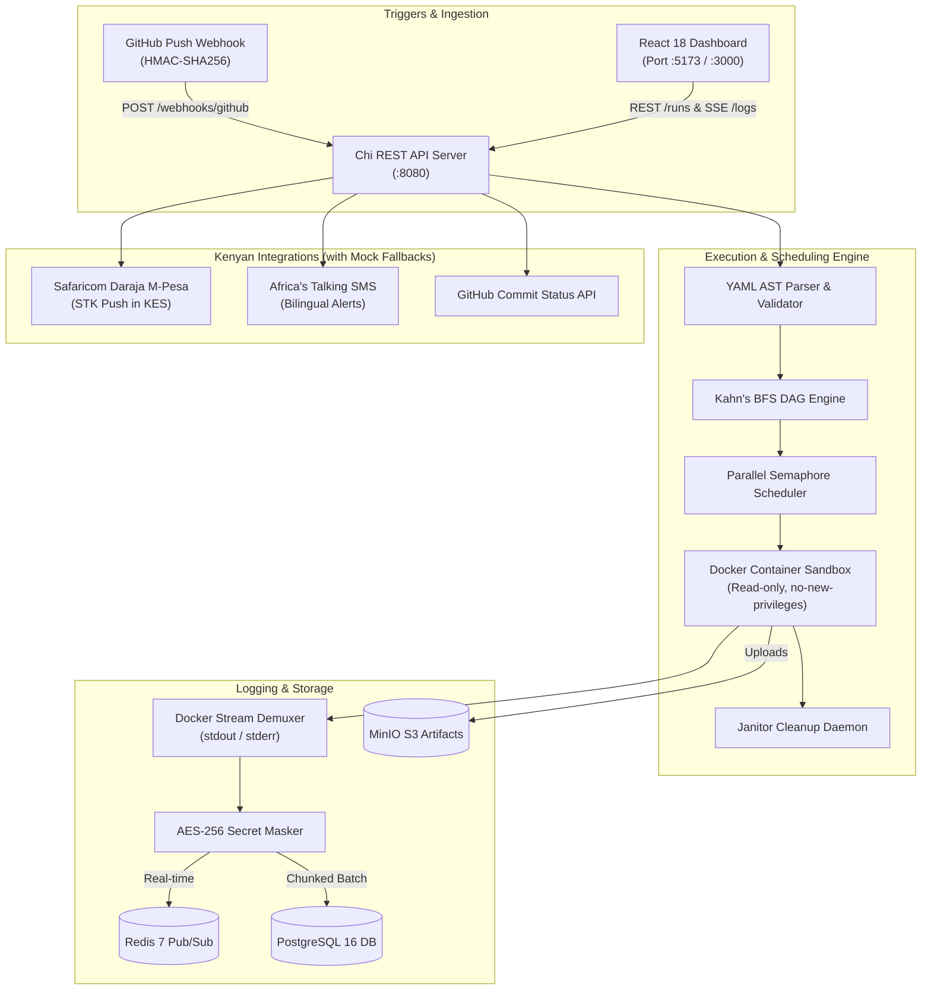

// path: README.md
# Forge CI (`forge-ci`)

> **Self-hosted, air-gappable CI/CD platform and real-time log-streaming engine.**  
> Built by Chris (Nairobi, Kenya; `Africa/Nairobi`) for resilient, isolated, on-premise builds.

[](https://github.com/crnji/forge-ci/actions)
[](LICENSE)
[](https://golang.org)
[](https://react.dev)
[](https://developer.safaricom.co.ke/)

---

## 1. Overview

**Forge CI** executes declarative YAML pipelines inside isolated, ephemeral Docker environments. Designed from the ground up for teams requiring complete data sovereignty, predictable resource limits, and real-time observability:

* **Air-Gappable & Offline-First**: Runs fully offline or behind private firewalls. Toggle `USE_MOCK_INTEGRATIONS=true` to test and develop with zero paid credentials or external internet access.
* **Strict Container Sandboxing**: Enforces `ReadonlyRootfs: true`, `SecurityOpt: ["no-new-privileges:true"]`, `CapDrop: ["ALL"]`, `Privileged: false`, and memory/CPU quotas (`NanoCPUs`).
* **Kahn's BFS DAG Engine**: Resolves step dependencies into deterministic parallel execution tiers, with DFS cycle detection and skip cascade propagation.
* **Dual-Layer Real-Time Logs**: Sub-millisecond log streaming over Server-Sent Events (SSE) backed by Redis Pub/Sub, with chunked batch persistence to PostgreSQL and `Last-Event-ID` reconnection replay.
* **AES-256-GCM Secrets Vault & Stream Scrubbing**: Authenticated encryption at rest with dynamic multi-line, base64, and URL-encoded log scrubbing.
* **S3-Compatible Artifact Storage**: Recursive file globbing and MinIO storage with presigned download URLs.
* **Kenyan Developer Billing**: Metered compute billing in Kenyan Shillings (`KES 10.00 / minute`), Safaricom Daraja M-Pesa STK Push deposits, and bilingual SMS alerts (*"Kazi imefaulu!"* / *"Kazi imeshindwa!"*) via Africa's Talking.
* **Modern Web Dashboard**: React 18 + Vite + TypeScript dark-mode UI with interactive DAG graph visualization, live terminal log console, secrets management, and artifact downloads.

---

## 2. Architecture



---

## 3. Technology Stack

| Component | Technology / Library | Description |
|---|---|---|
| **API Backend** | Go 1.22+, `go-chi/v5`, `slog` | High-throughput, idiomatic HTTP REST API |
| **Database** | PostgreSQL 16, `jackc/pgx/v5` | Relational storage for runs, steps, logs, secrets, and billing |
| **Pub/Sub Broker** | Redis 7, `redis/go-redis/v9` | Real-time log broadcasting over Server-Sent Events |
| **Container Engine** | Docker Engine SDK | Isolated container lifecycle management and resource quotas |
| **Artifact Storage** | MinIO S3, `minio/minio-go/v7` | S3-compatible object storage with presigned URLs |
| **Frontend UI** | React 18, Vite, TypeScript, Lucide | Dark-mode SPA with DAG visualizer and terminal streaming |
| **Mobile Payments** | Safaricom Daraja STK Push | M-Pesa usage credit billing priced in KES (with mock adapter) |
| **SMS Alerts** | Africa's Talking SMS API | Bilingual notifications to Kenyan phone numbers (`+254...`) |

---

## 4. Quick Start

### Option A: Local Development (Offline Mock Mode)

Run the entire platform on your machine without external credentials:

```bash
# 1. Clone repository
git clone https://github.com/crnji/forge-ci.git
cd forge-ci

# 2. Configure environment
cp .env.example .env

# 3. Start API server (PowerShell or Bash)
go run ./cmd/api
```
The API server will launch on `http://localhost:8080` with mock adapters enabled (`USE_MOCK_INTEGRATIONS=true`).

Start the Web UI in another terminal:
```bash
cd web
npm install
npm run dev
```
Open **`http://localhost:5173`** in your browser.

---

### Option B: Full Docker Compose Infrastructure

Launch PostgreSQL, Redis, MinIO, the API server, the runner daemon, and the Nginx web client:

```bash
docker-compose up -d
```

Services exposed:
* **Web UI**: `http://localhost:3000`
* **API Server**: `http://localhost:8080`
* **MinIO Console**: `http://localhost:9001` (user: `forge_minio_admin`, pass: `forge_minio_secret`)
* **PostgreSQL**: `localhost:5432`
* **Redis**: `localhost:6379`

---

## 5. Pipeline DSL Specification

Create a pipeline file (e.g. `.forge-ci.yml`):

```yaml
version: 1
name: forge-diamond-pipeline

steps:
  - id: checkout
    name: Source Checkout
    image: alpine/git:latest
    run: git clone https://github.com/crnji/forge-ci.git .

  - id: lint
    name: Code Quality Check
    image: golang:1.22-alpine
    run: go vet ./...
    depends-on: [checkout]
    resources:
      cpu: 1.0
      memory: 512m

  - id: test
    name: Unit & Integration Tests
    image: golang:1.22-alpine
    run: go test -v ./...
    depends-on: [checkout]
    resources:
      cpu: 2.0
      memory: 1g

  - id: build
    name: Binary Compilation
    image: golang:1.22-alpine
    run: go build -o dist/app ./...
    depends-on: [lint, test]
    artifacts:
      - dist/**

secrets:
  - DEPLOY_TOKEN
```

---

## 6. Security & Architectural Decision Records

* **[Security Hardening & Threat Model](docs/security.md)**: Deep dive into `/var/run/docker.sock` isolation, read-only root filesystems, dropped capabilities, and AES-256-GCM secret protections.
* **[ADR 0001: Container Isolation & Resource Limits](docs/adr/0001-container-isolation-and-limits.md)**
* **[ADR 0002: SSE & Redis Dual-Layer Log Streaming](docs/adr/0002-sse-redis-dual-layer-logs.md)**
* **[ADR 0003: M-Pesa Daraja Usage Credits & Offline Metering](docs/adr/0003-mpesa-daraja-usage-credits.md)**

---

## 7. Automated Testing & Verification

Run the test suite across backend packages and frontend bundle:

```bash
# Go verification
go vet ./...
go test -v ./...

# Frontend compilation
cd web
npm run build
```

---

## 8. Packaging, Releases & Production Deployments

### A. Release Packaging (Multi-Platform Binaries)

Forge CI binaries (`forge-api` and `forge-runner`) can be cross-compiled for Linux (`amd64`, `arm64`), macOS (`amd64`, `arm64`), and Windows (`amd64`):

```bash
# POSIX / Linux / macOS release build & packaging
./scripts/build_release.sh v1.0.0

# Windows PowerShell release packaging
powershell -ExecutionPolicy Bypass -File ./scripts/package.ps1 -Version v1.0.0
```
Releases are automatically published on GitHub when pushing a git semver tag (`git tag -a v1.0.0 -m "Release v1.0.0" && git push origin v1.0.0`) via GoReleaser and GitHub Container Registry (`ghcr.io`).

### B. Production Deployment Options

#### 1. Hardened Production Docker Compose (with Caddy Automatic TLS)
```bash
cp deployments/.env.example .env
# Edit .env with your production credentials
docker compose -f deployments/docker-compose.prod.yml up -d
```

#### 2. Kubernetes Cluster Deployment (Kustomize)
```bash
# Review and configure deployments/k8s/01-configmap.yaml and 02-secrets.yaml
kubectl apply -k deployments/k8s
```

#### 3. Bare-Metal Linux Host / Air-Gapped Systemd
```bash
cd deployments/systemd
sudo bash install.sh
sudo systemctl enable --now forge-api forge-runner
sudo systemctl status forge-api forge-runner
```

---

## 9. License & Author

Crafted with dedication by **Chris** in Nairobi, Kenya (`Africa/Nairobi`).  
Licensed under the [MIT License](LICENSE).
