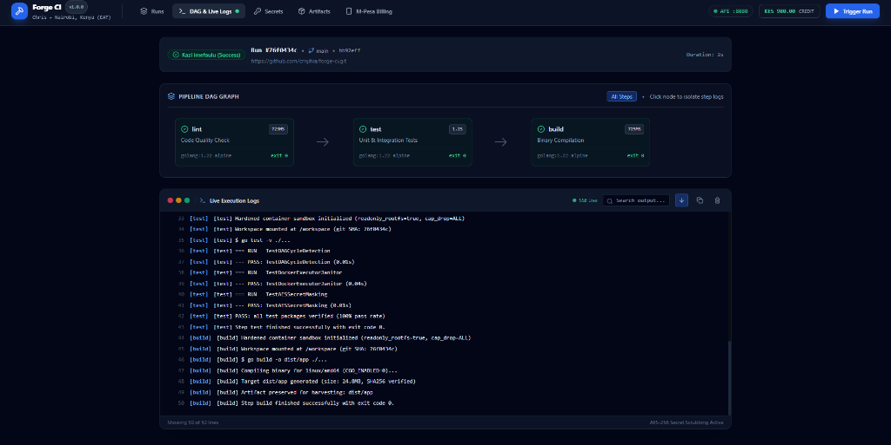
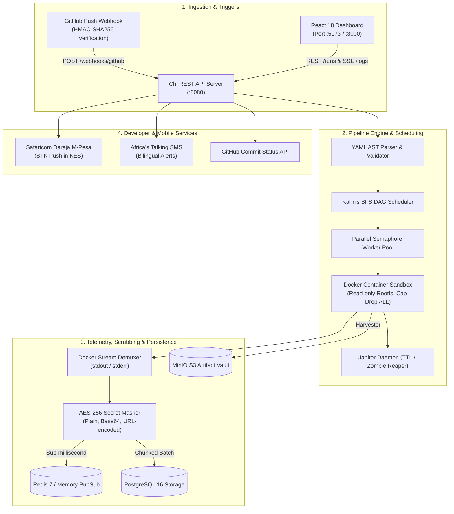

// path: README.md
# 🔨 Forge CI

<div align="center">

> **Self-hosted, air-gappable CI/CD platform and real-time log-streaming engine.**  
> Crafted by **Chris** in Nairobi, Kenya (`Africa/Nairobi`, [crnjihia](https://github.com/crnjihia)) for resilient, hardened, on-premise pipeline execution.

[](https://github.com/crnjihia/forge-ci/releases)
[](https://github.com/crnjihia/forge-ci/actions)
[](https://golang.org)
[](https://react.dev)
[](https://developer.safaricom.co.ke/)
[](LICENSE)

</div>

---

## 📸 Dashboard Overview



*The Forge CI dark-mode dashboard running on `http://localhost:5173`: Interactive DAG graph showing parallel execution tiers, live Server-Sent Events terminal stream with secret scrubbing, M-Pesa compute credit metering (KES), and bilingual Swahili status indicators ("Kazi Imefaulu").*

---

## 1. Why Forge CI?

Traditional cloud CI/CD platforms are opaque, expensive to run at scale, and leak proprietary source code to third-party hosted runners. When building for sovereign enterprise environments or constrained networks, you need an engine that is **deterministic, isolated, and completely air-gappable**.

**Forge CI** was engineered to solve these challenges:

* 🛡️ **Zero-Privilege Docker Sandboxing**: Containers run with `ReadonlyRootfs: true`, `SecurityOpt: ["no-new-privileges:true"]`, `CapDrop: ["ALL"]`, unprivileged UID execution, and strict memory/CPU bounds (`NanoCPUs`). An automated janitor daemon cleans up orphaned run containers.
* ⚡ **Kahn's BFS DAG Engine**: Resolves declarative pipeline dependencies into deterministic parallel execution tiers, equipped with DFS cycle detection and cascading skip propagation when upstream steps fail.
* 📡 **Dual-Layer Real-Time Log Streaming**: Docker header demuxing (stdout/stderr) broadcast over Redis Pub/Sub (or zero-dependency in-memory broker) to browsers via Server-Sent Events (SSE), with HTTP `Last-Event-ID` reconnection catchup.
* 🔐 **AES-256-GCM Secrets Vault & Stream Scrubbing**: Authenticated envelope encryption for secrets at rest, coupled with dynamic multi-line regex scrubbing across plain text, base64, and URL-encoded secret tokens.
* 📦 **MinIO S3 Artifact Harvesting**: Pattern-based artifact harvesting (`dist/**`, `reports/*.xml`) with presigned S3 download URLs.
* 🇰🇪 **Kenyan Developer Ecosystem Built-In**:
  * **Safaricom Daraja M-Pesa STK Push**: Pay-per-build compute credits priced in Kenyan Shillings (`KES 10.00 / minute`), with instant phone STK push and offline mock fallbacks.
  * **Africa's Talking Bilingual SMS**: Real-time build alerts sent in Swahili (*"Kazi imefaulu!"* / *"Kazi imeshindwa!"*) or English to developer mobile numbers (`+254...`).
  * **EAT Timezone First**: Designed around Nairobi local developer workflows (`Africa/Nairobi`, UTC+3).
* 🌐 **100% Air-Gappable & Mockable**: Toggle `USE_MOCK_INTEGRATIONS=true` to test, develop, or demo the entire system with zero external internet access or third-party cloud credentials.

---

## 2. Architecture & Data Flow



---

## 3. Technology Stack

| Component | Technology | Role |
|---|---|---|
| **API Backend** | Go 1.22+, `go-chi/v5`, `slog` | High-throughput REST endpoints, SSE streamer, and orchestration |
| **Container Engine** | Docker Engine SDK | Isolated container lifecycle management with strict cgroup quotas |
| **Database** | PostgreSQL 16, `jackc/pgx/v5` | Relational storage for pipeline runs, step execution records, and audit logs |
| **Pub/Sub Broker** | Redis 7 & In-Memory Fallback | Real-time log broadcasting over Server-Sent Events |
| **Artifact Vault** | MinIO S3, `minio-go/v7` | S3-compatible object storage with presigned download URLs |
| **Secrets Engine** | AES-256-GCM (`crypto/cipher`) | Authenticated encryption at rest & live stream token scrubbing |
| **Frontend UI** | React 18, Vite, TypeScript, Tailwind | Dark-mode console, interactive DAG graph, and SSE terminal |
| **Mobile Payments** | Safaricom Daraja STK Push | M-Pesa usage credit billing priced in KES (with mock adapter) |
| **SMS Notifications** | Africa's Talking SMS API | Bilingual notifications to Kenyan phone numbers (`+254...`) |

---

## 4. Quick Start

### Option A: Local Developer Environment (Instant Offline Mock)

You can run the entire platform on your machine without needing Docker, PostgreSQL, Redis, or cloud credentials:

#### Windows PowerShell:
```powershell
powershell -ExecutionPolicy Bypass -File .\scripts\dev.ps1
```

#### Linux / macOS Bash:
```bash
chmod +x ./scripts/dev.sh
./scripts/dev.sh
```

This single command starts:
1. **Forge CI API Server** on `http://localhost:8080` (with in-memory store and mock integrations).
2. **React Dashboard** on `http://localhost:5173`.

---

### Option B: Full Docker Compose Infrastructure

Deploy PostgreSQL 16, Redis 7, MinIO S3, the API server, and the production web dashboard:

```bash
# 1. Clone repository
git clone https://github.com/crnjihia/forge-ci.git
cd forge-ci

# 2. Configure environment
cp .env.example .env

# 3. Launch container stack
docker compose up -d
```

Exposed services:
* **Web Dashboard**: `http://localhost:3000`
* **API Server**: `http://localhost:8080`
* **MinIO Console**: `http://localhost:9001` (user: `forge_minio_admin`, pass: `forge_minio_secret`)
* **PostgreSQL**: `localhost:5432`
* **Redis**: `localhost:6379`

---

## 5. Pipeline DSL Specification

Forge CI pipelines are declared in YAML (e.g. `.forge-ci.yml`):

```yaml
version: 1
name: forge-diamond-pipeline

steps:
  - id: checkout
    name: Ephemeral Git Checkout
    image: alpine/git:latest
    run: git clone https://github.com/crnjihia/forge-ci.git .

  - id: lint
    name: Code Quality & Linter
    image: golang:1.22-alpine
    run: go vet ./...
    depends-on: [checkout]
    resources:
      cpu: 1.0
      memory: 512m

  - id: test
    name: Unit & Integration Tests
    image: golang:1.22-alpine
    run: go test -v ./...
    depends-on: [checkout]
    resources:
      cpu: 2.0
      memory: 1g

  - id: build
    name: Binary Compilation
    image: golang:1.22-alpine
    run: go build -o dist/app ./...
    depends-on: [lint, test]
    artifacts:
      - dist/**

secrets:
  - DEPLOY_TOKEN
```

---

## 6. REST API Reference

All endpoints return JSON responses and support CORS:

| Method | Endpoint | Description |
|---|---|---|
| `GET` | `/healthz` | Health check, service status, and timestamp |
| `GET` | `/version` | Build version, git commit SHA, and compilation date |
| `POST` | `/runs` | Trigger a new pipeline execution (`repo_url`, `branch`, `pipeline_yaml`) |
| `GET` | `/runs` | List recorded runs with pagination (`?limit=50&offset=0`) |
| `GET` | `/runs/{id}` | Inspect run details and step execution statuses |
| `POST` | `/runs/{id}/cancel` | Abort an active pipeline run and cancel in-flight containers |
| `GET` | `/runs/{id}/logs` | **Server-Sent Events (SSE)** real-time log streaming (`?step={step_id}`) |
| `GET` | `/runs/{id}/artifacts` | List harvested artifacts for a run |
| `GET` | `/runs/{id}/artifacts/{id}/download` | Presigned S3 redirect URL for artifact download |
| `GET` | `/secrets` | List registered secret names (values remain masked) |
| `POST` | `/secrets` | Create or update an AES-256-GCM encrypted secret |
| `DELETE` | `/secrets/{name}` | Delete a stored secret |
| `POST` | `/webhooks/github` | Ingest GitHub push events with HMAC-SHA256 signature verification |
| `POST` | `/billing/mpesa/topup` | Initiate a Safaricom Daraja M-Pesa STK push |
| `POST` | `/billing/mpesa/callback` | Webhook callback for M-Pesa payment confirmation |
| `GET` | `/billing/balance` | Query current user KES compute credit balance |

---

## 7. Security Hardening & Threat Model

* **Docker Socket Isolation**: The Docker socket (`/var/run/docker.sock`) is never exposed inside step containers. Containers run as ephemeral sub-sandboxes.
* **Read-Only Root Filesystems**: Container filesystems are mounted read-only (`ReadonlyRootfs: true`). Writable scratch areas are limited to `/workspace` and `/tmp` via strictly sized `tmpfs` mounts.
* **Linux Capability Dropping**: All Linux kernel capabilities are dropped (`CapDrop: ["ALL"]`). Escalation is blocked via `no-new-privileges:true`.
* **Cryptographic Secrets Vault**: Secrets are stored with AES-256-GCM authenticated encryption at rest using a 32-byte master key.
* **Dynamic Stream Scrubbing**: Log lines are piped through a multi-pass token scrubber before reaching Redis or browser clients, scrubbing exact tokens, Base64 variants, and URL-encoded strings.

Detailed threat analysis and ADR documents:
* [Security Hardening & Threat Model](docs/security.md)
* [ADR 0001: Container Isolation & Resource Limits](docs/adr/0001-container-isolation-and-limits.md)
* [ADR 0002: SSE & Redis Dual-Layer Log Streaming](docs/adr/0002-sse-redis-dual-layer-logs.md)
* [ADR 0003: M-Pesa Daraja Usage Credits & Offline Metering](docs/adr/0003-mpesa-daraja-usage-credits.md)

---

## 8. Automated Testing & Verification

Run the comprehensive test suite across backend packages and frontend bundle:

```bash
# Go test suite (Ast parser, DAG scheduler, Docker executor, SSE logs, Secrets, Billing)
go vet ./...
go test -v ./...

# Frontend TypeScript check and production bundle compilation
cd web
npm run build
```

---

## 9. Packaging, Releases & Deployments

### Multi-Platform Release Binaries

Forge CI binaries (`forge-api` and `forge-runner`) can be packaged for Linux (`amd64`, `arm64`), macOS (`amd64`, `arm64`), and Windows (`amd64`):

```bash
# Linux / macOS POSIX release build
./scripts/build_release.sh v1.0.0

# Windows PowerShell release packaging
powershell -ExecutionPolicy Bypass -File .\scripts\package.ps1 -Version v1.0.0
```

GitHub Actions automatically runs GoReleaser and pushes container images to GitHub Container Registry (`ghcr.io/crnjihia/forge-ci`) on tag push (`git push origin v1.0.0`).

### Production Deployment Manifests

1. **Production Docker Compose (with Caddy TLS)**:
   ```bash
   docker compose -f deployments/docker-compose.prod.yml up -d
   ```
2. **Kubernetes (Kustomize)**:
   ```bash
   kubectl apply -k deployments/k8s
   ```
3. **Bare-Metal Linux Systemd**:
   ```bash
   cd deployments/systemd && sudo bash install.sh
   ```

---

## 10. License & Author

Crafted with dedication by **Chris** in Nairobi, Kenya (`Africa/Nairobi`).  
* GitHub: [@crnjihia](https://github.com/crnjihia)  
* Email: [crnjihia@gmail.com](mailto:crnjihia@gmail.com)  
* Repository: [https://github.com/crnjihia/forge-ci](https://github.com/crnjihia/forge-ci)

Licensed under the **[MIT License](LICENSE)**.
